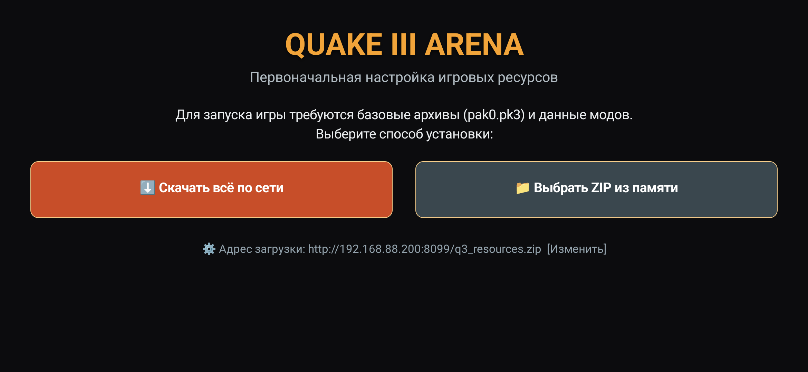
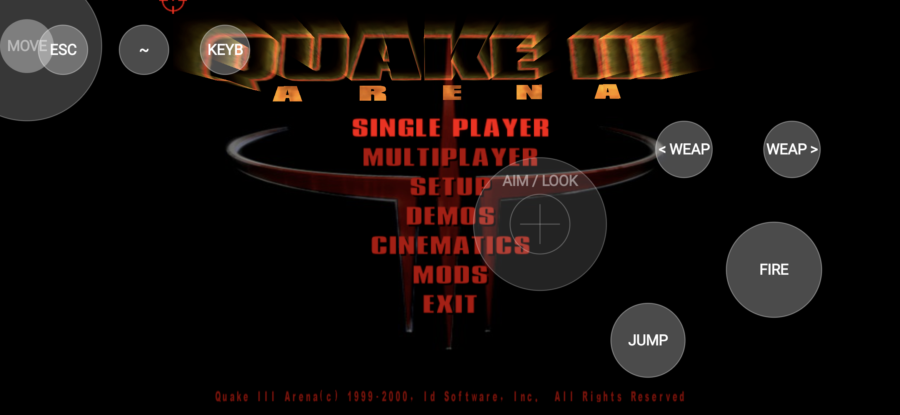
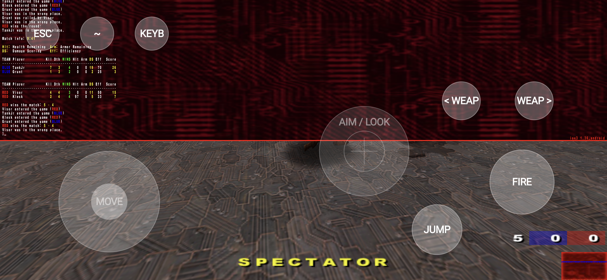

# ioquake3 for Modern Android

<p align="center">
  
</p>

<p align="center">
  <b>A modern, high-performance port of ioquake3 (Quake III Arena) for Android 8.0 – 15+</b><br>
  Featuring Edge-to-Edge display support, dynamic HUD with external peripheral auto-hide, 1:1 crosshair aspect ratio correction, and zero-ADB in-app resource setup.
</p>

<p align="center">
  
  
  
  
</p>

<p align="center">
  <a href="https://github.com/0x800700">
    
  </a><br>
  <b>Crafted with ❤️ by <a href="https://github.com/0x800700">ProBably Works</a></b>
</p>

---

## 🎮 Key Features

* **True Edge-to-Edge Fullscreen**:
  - Full support for modern smartphone cutouts (`LAYOUT_IN_DISPLAY_CUTOUT_MODE_SHORT_EDGES`).
  - Native display resolution (e.g. 2340x1080, 19.5:9 / 20:9 / 21:9) without black bars, stretched navigation insets, or clipped HUD health/armor counters.
  - High refresh-rate support (90Hz / 120Hz display panels).

* **Smart Dynamic Touch HUD & Peripheral Auto-Hide**:
  - **On-Screen Touch Controls**: Virtual analog stick (`MOVE`), sub-pixel look touchpad (`AIM / LOOK`), action buttons (`FIRE`, `JUMP`, `< WEAP`, `WEAP >`, `ESC`, `~`, `KEYB`).
  - **Auto-Hide on Peripheral Connect**: When an external keyboard, mouse, USB dock, or Bluetooth controller (Xbox, DualSense, Razer) is detected, on-screen controls **automatically hide**, leaving 100% of the screen clear and only a subtle semi-transparent `~` (Console) button.
  - **Smart Filtering**: Hardware fingerprint sensors and internal keys are recognized as internal and will not falsely trigger peripheral mode.
  - **Hotplug Resilient**: Safe USB reconnection handling without binder crashes.

* **1:1 Crosshair Aspect Ratio Correction**:
  - Eliminates the classic Quake 3 widescreen stretch bug where 2D elements are stretched horizontally on modern displays.
  - Crosshairs render as perfect circles (1:1 aspect ratio) across any FOV (90°, 115°, etc.) and resolution.

* **Zero-ADB Setup (In-App Downloader & SAF Importer)**:
  - Overcomes Android 11+ scoped storage restrictions (`/Android/data/` lock).
  - First-launch screen provides:
    - ⬇️ **One-click Network Download**: Automatically downloads and installs required assets with resume support and real-time speed/progress indicators.
    - 📁 **Local ZIP Import**: Open any game ZIP archive using Android's native system file picker (Storage Access Framework).
    - ⚡ **Instant Launch**: On subsequent runs, the game boots directly into Quake III in milliseconds.

* **Mod Compatibility**:
  - Out-of-the-box support for **BaseQ3**, **OSP**, and **Excessive Plus (E+)**.
  - OpenAL / SDL2 audio subsystem recovery on map change and server reconnection.

---

## 📸 Screenshots

<p align="center">
  <br>
  <i>Initial In-App Resource Setup & Downloader</i>
</p>

<p align="center">
  <br>
  <i>Quake III Arena Main Menu with Edge-to-Edge Display</i>
</p>

<p align="center">
  <br>
  <i>In-game match with Touch Controls and 1:1 Round Crosshair</i>
</p>

---

## 🚀 Installation & Quick Start

1. Download the latest **`ioquake3-v1.0.0-release.apk`** from [**Releases**](https://github.com/0x800700/ioquake3-android/releases).
2. Install the APK on your Android device (enable "Install unknown apps" if prompted).
3. Open the game:
   - If game data is not yet present, select **«Скачать всё по сети»** (Download via Network) or **«Выбрать ZIP из памяти»** (Import ZIP from device).
   - Once assets are unpacked, Quake III Arena launches automatically!

---

## 🛠 Building from Source

The project includes a reproducible Docker build environment with Android NDK 26 and CMake 3.22.

### Prerequisites
- Docker (Docker Desktop on macOS/Windows, or Docker on Linux)
- Bash

### Build Steps

1. Clone the repository:
   ```bash
   git clone https://github.com/0x800700/ioquake3-android.git
   cd ioquake3-android
   ```

2. Build the Docker builder image (one-time step):
   ```bash
   docker build -t ioq3-android-builder -f Dockerfile.build .
   ```

3. Build the Release APK:
   ```bash
   ./scripts/docker-build.sh assembleRelease
   ```

The compiled and signed APK will be located at:
```text
android/app/build/outputs/apk/release/app-release.apk
```

---

## 🏗 Architecture Overview

```
├── android/                 # Android Studio Gradle Project
│   ├── app/src/main/java/   # LauncherActivity (Downloader/SAF), MainActivity, TouchOverlayView
│   ├── app/src/main/res/    # Official Quake 3 Tango adaptive launcher icons
│   └── app/src/main/cpp/    # CMake build linking ioq3, SDL2, and gl4es
├── ioq3/                    # ioquake3 C engine codebase
│   ├── code/renderergl1/    # OpenGL 1.x / GL4ES backend (with 1:1 crosshair aspect ratio fix)
│   ├── code/sdl/            # SDL2 audio device reuse and video initialization
│   └── code/sys/            # Android storage paths and headless dialog handling
├── external/
│   ├── SDL2/                # SDL 2.x with Android HID hotplug safety patches
│   └── gl4es/               # OpenGL 2.1 to GLES 2.0 translation layer
├── scripts/                 # Docker build runner scripts
└── Dockerfile.build         # Ubuntu + Android SDK 34 + NDK 26 builder container
```

---

## 📜 Credits & License

- **Port Developer & Maintainer**: **[ProBably Works](https://github.com/0x800700)**
- **Quake III Arena** © 1999–2000 id Software LLC, a ZeniMax Media company.
- **ioquake3** by the [ioquake3 contributors](https://ioquake.org/).
- **SDL (Simple DirectMedia Layer)** by Sam Lantinga and [libsdl-org](https://www.libsdl.org/).
- **gl4es** by Sébastien Chevalier ([ptitSeb](https://github.com/ptitSeb/gl4es)).

This project is licensed under the **GNU General Public License v2.0 (GPLv2)**. See [LICENSE](LICENSE) for details.
